# UR10e Robot Arm Catches a Thrown Ball with AI Prediction in MuJoCo

[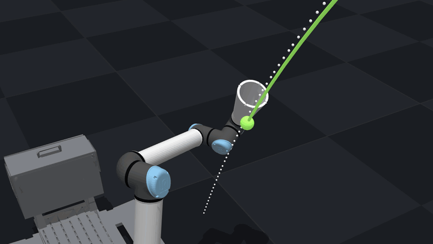](https://www.youtube.com/@RomanParak/videos)

**Figure 1:** A simulated moving catch, close up (a validation throw of `Catch_In`). Click the image for the video.

> [!WARNING]
> **Simulation only.** Every output is a simulation result. Nothing is run on, or validated on, the real UR10e.

▶ **[Watch the video (79 s)](https://www.youtube.com/@RomanParak/videos)**

A UR10e robot arm with a passive, cone-shaped cup catches a thrown ball in a MuJoCo simulation. The ball's flight
model is identified from 90 real throws recorded with a 12-camera Qualisys motion-capture system. A learned
predictor forecasts the rest of a flight from its first observed points, a conservative decision says whether the
ball can be caught, the robot re-plans its motion as new points arrive and meets the ball in motion, and the catch
itself is simulated with contact. Everything runs from the command line in Python 3.11 on macOS (Apple silicon).
The learned predictor is trained with PyTorch and runs in NumPy.

- **Same accuracy, about 58× faster.** The AI predictor is as accurate as the physics fit and answers in 0.4–0.9 ms
  ([docs/SPEC.md §4.9](docs/SPEC.md)).
- **99.3 % of catch attempts caught**, the moving catch on the `Catch_In` test throws at 800 °/s², with an assumed
  restitution of 0.20 ([§4.16](docs/SPEC.md)).
- **0 false go** on the 4 681 uncatchable `Catch_Near` test throws at 800 °/s²: the robot never moved for a ball it
  could not catch ([§4.11](docs/SPEC.md)).

## How it works

<picture>
  <source media="(prefers-color-scheme: dark)" srcset="Media/readme_pipeline_dark.png">
  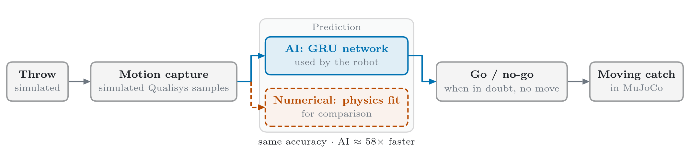
</picture>

**Figure 2:** From throw to catch: the robot acts on the AI prediction, the numerical one being the comparison. The
observation model was identified from 45 of the 90 real Qualisys recordings. The other 45 are held out for evaluation.

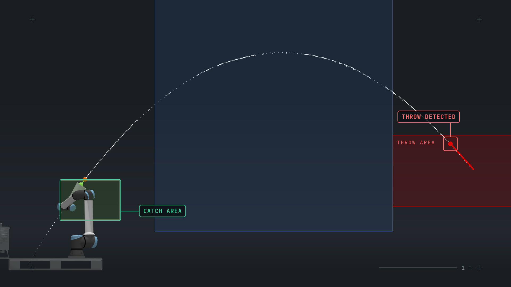

**Figure 3:** The simulated cell from the side: the throw is detected in the throw area (right), and the robot
catches inside its catch area (left, green). A validation throw of the `Catch_In` dataset, simulated.

1. **Data.** 90 real flights (100, 200 and 300 Hz) give the flight model, gravity with quadratic drag
   (`a = g − k·|v|·v`, k = 0.009305 1/m), and an observation model of the motion-capture error and its dropouts. Half
   of the flights identify the models, and the other 45 are held out. Simulated throws are generated from both models.
2. **Prediction.** From the first N observed samples (N = 10, 20, 40, …) a predictor returns the whole remaining
   trajectory to the floor. Two predictors ship: `QT_BASIS`, the AI predictor (a GRU neural network over the
   observed samples with a Chebyshev basis of degree 6 as its output, trained in PyTorch), and `GLS_M4`, the numerical
   predictor (a physics model with a Gauss–Newton fit under the flight model, weighted by the observation model's
   covariance).

<picture>
  <source media="(prefers-color-scheme: dark)" srcset="Media/readme_model_dark.png">
  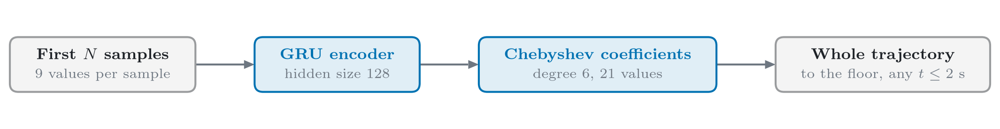
</picture>

**Figure 4:** The AI model, `QT_BASIS`: a GRU encodes the first N samples, and the Chebyshev coefficients it returns
give the ball's position at any time up to 2 s ahead, to the floor.

3. **Decision.** At every new sample the predicted catch point must clear cross-track and time margins, calibrated
   on simulated data at the 95 % quantile, inside the catch area the robot reaches in time. When in doubt, no move.
4. **Moving catch.** The robot is re-planned at every sample with time-optimal joint profiles within the UR10e's
   limits, every path checked for collisions by exact distances. It then meets the ball with a stroke along the
   ball's path, so that the ball arrives with less speed relative to the cup, and the catch is simulated with contact.

<p align="center">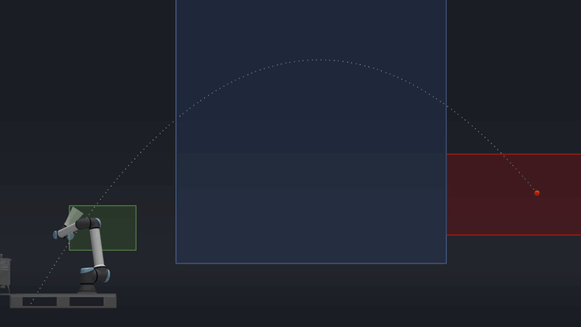</p>

**Figure 5:** The prediction converging as the observed samples arrive, then the catch, slowed down and zoomed in
(side view of a simulated throw).

## Key results

All numbers are simulation results: the real flights identify the models and measure the prediction error, and the
robot catches simulated throws only. Sources are the sections of [docs/SPEC.md](docs/SPEC.md).

| Result | Value | Source |
|---|---|---|
| Prediction error after 40 samples, simulated test throws (median RMS over the rest of the flight) | `QT_BASIS` 22.4 mm, `GLS_M4` 21.1 mm | §4.9 |
| Same, on the 45 held-out real flights | `QT_BASIS` 22.6 mm, `GLS_M4` 20.6 mm | §4.9 |
| Paired difference on the real flights, `QT_BASIS` − `GLS_M4`, after 10 samples | −0.29 mm, 95 % interval [−0.72, +0.26] | §4.9 |
| Inference per trajectory (one process, one thread, CPU) | `QT_BASIS` 0.42–0.83 ms, `GLS_M4` 24–50 ms: about 58× faster | §4.9 |
| False go: a move started for a ball that cannot be caught (`Catch_Near` test throws) | 0 of 4 681 / 4 718 (800 / 400 °/s²) | §4.11 |
| Moving catch, `Catch_In` test throws, the balls retained of the goes (5 seeds) | 99.3 % / 98.4–98.6 % (800 / 400 °/s²), static catch 95.7–97.5 % / 95.0–97.4 % | §4.16 |
| Moving catch, `Catch_In` test throws, the balls retained of the catchable throws (mean) | 87.7 % / 80.0 % (800 / 400 °/s²) | §4.16 |

`GLS_M4` is as accurate, but one prediction takes it about 24–133 ms, too slow for the 3.3–10 ms re-planning period,
so the catch runs use `QT_BASIS`. Its catch rate was not measured.

The catch rates hold for an *assumed* restitution of the ball of 0.20 and an *assumed* joint acceleration of
800 °/s² (400 °/s² as the conservative case). See [docs/KNOWN_ISSUES.md](docs/KNOWN_ISSUES.md).

<picture>
  <source media="(prefers-color-scheme: dark)" srcset="Media/readme_comparison_bars_dark.png">
  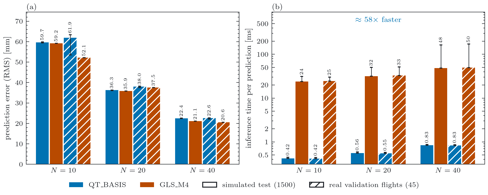
</picture>

**Figure 6:** (a) The prediction error (median over the flights of the RMS over the rest of the flight) after N
observed samples, on the simulated test throws (plain) and the 45 real held-out flights (hatched). The error bar is
the range over `QT_BASIS`'s 5 training seeds. (b) The inference time per prediction, median and 90th percentile.
Same accuracy, about 58 times faster. From the stored final evaluations.

<picture>
  <source media="(prefers-color-scheme: dark)" srcset="Media/readme_prediction_error_dark.png">
  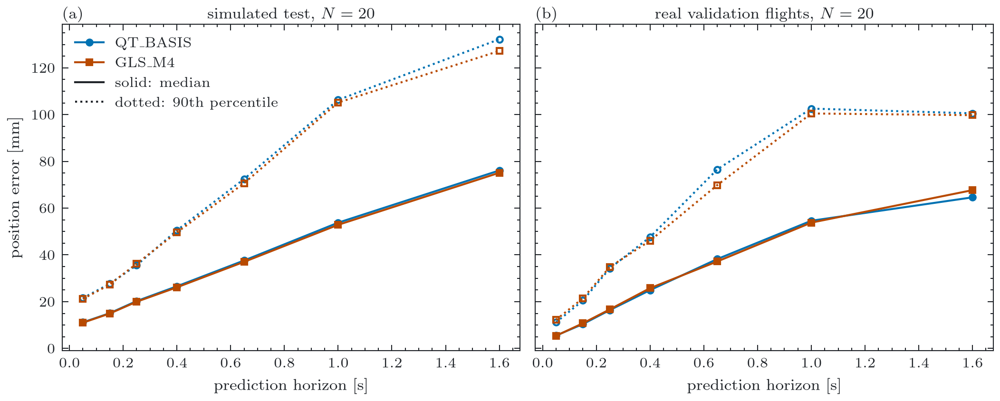
</picture>

**Figure 7:** The position error against the prediction horizon after 20 observed samples, (a) on the simulated test
throws (against the exact truth), (b) on the 45 real held-out flights (against the recorded samples). The median is a
solid line, the 90th percentile dotted.

<picture>
  <source media="(prefers-color-scheme: dark)" srcset="Media/readme_prediction_dark.png">
  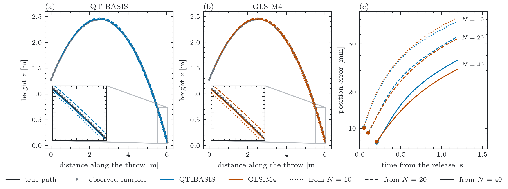
</picture>

**Figure 8:** Both predictors on one simulated validation throw (`Default` 8327, chosen by a stated rule as a
typical one), from the first N samples against the true path, and their position error against the time.

<picture>
  <source media="(prefers-color-scheme: dark)" srcset="Media/readme_real_dark.png">
  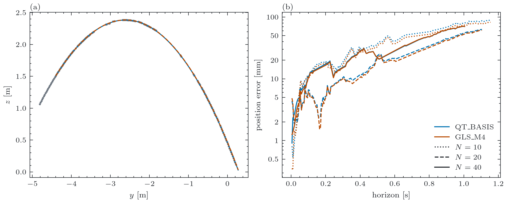
</picture>

**Figure 9:** A real recorded flight: (a) the side view with both predictions from the first 20 samples, (b) the
position error against the horizon for N = 10, 20, 40. It is one of the 45 flights that shaped the models, so a
demonstration, not an independent evaluation, placed in the robot frame by an assumed transform.

<picture>
  <source media="(prefers-color-scheme: dark)" srcset="Media/readme_catch_dark.png">
  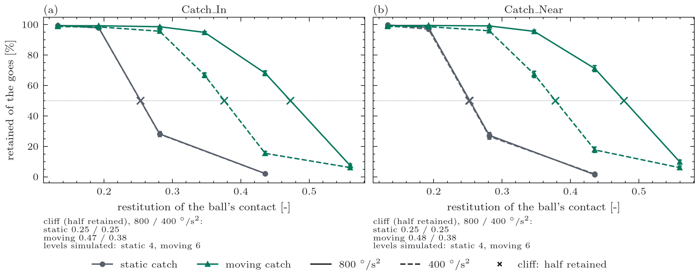
</picture>

**Figure 10:** The share of the go decisions whose ball stays in the cup, against the ball's restitution, for the
static and the moving catch (`Catch_In` and `Catch_Near` validation throws, seed 0). The moving catch moves the cliff
from about 0.25 to about 0.47 / 0.38 (800 / 400 °/s²). The nominal restitution, 0.20, is assumed.

<picture>
  <source media="(prefers-color-scheme: dark)" srcset="Media/readme_motion_dark.png">
  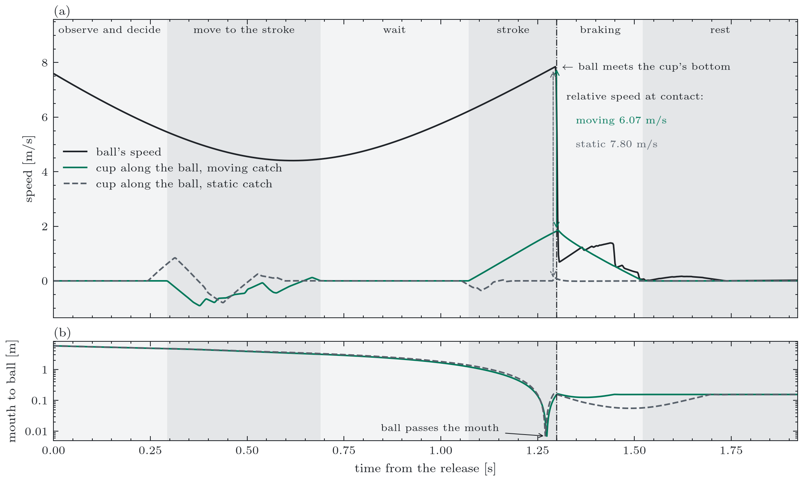
</picture>

**Figure 11:** One moving catch (`Catch_In` validation throw 1000, 800 °/s²): the cup's speed along the ball beside the
ball's speed, with the phases observe, move, wait, stroke, brake and rest. The ball meets the cup at 6.07 m/s
relative speed against 7.80 m/s for the static catch of the same throw.

## Installation

Prerequisites: macOS on Apple silicon (the only platform verified) and Python 3.11 from Homebrew
(`brew install python@3.11`). LaTeX (`latex`, `dvipng`) is optional and only sets the figures' text.

```bash
git clone <URL>   # example: the repository's URL
cd UR10e_Qualisys_Ball_Catching
./install.sh      # .venv with the pinned requirements; checks the vendored UR10e
```

## Usage

Generated data goes to `Data/Generated/` (git-ignored). A fresh clone holds the recordings, the configuration and
the scene, not the generated datasets, the trained models or the results: they are made by the commands below, in
this order. The times were measured on an Apple M2 Pro.

```bash
.venv/bin/python scripts/catch.py --help
# example: the seven datasets (about 20 s per 10 000 throws): Default from Config/dataset.yaml, then the six of Config/Datasets/
.venv/bin/python scripts/catch.py dataset
for name in Catch_In Catch_Near Noise_0 Noise_0_25 Noise_0_5 Noise_1_5; do .venv/bin/python scripts/catch.py dataset --config Config/Datasets/$name.yaml; done
# example: train QT_BASIS, 5 seeds on the CPU (about 17 min each), and evaluate it on simulated validation throws
.venv/bin/python scripts/catch.py train
.venv/bin/python scripts/catch.py evaluate --run Data/Generated/Models/QT_BASIS
# example: the decision, the interception and the physical catch of every go (about 3.8 h with 10 workers)
.venv/bin/python scripts/catch.py catch --run Data/Generated/Models/QT_BASIS --workers 10
# example: watch one throw in MuJoCo's viewer (macOS needs the mjpython launcher)
.venv/bin/mjpython scripts/catch.py view --run Data/Generated/Models/QT_BASIS --index 1000
# example: the figures of the stored results
.venv/bin/python scripts/plots.py all
```

`scripts/catch.py` has the sub-commands `dataset`, `train`, `evaluate`, `compare`, `catch` and `view`.
`scripts/Maintenance/derive.py` holds what the shipped configuration and the catch area were derived with
(`recordings`, `identify`, `observation`, `workspace`, `scene`, `dataset-check`, `sweep`). `evaluate` and `catch` with
`--partition test`, and `scripts/Maintenance/derive.py identify`, read held-out data and count every call in a ledger: the final
evaluation is read once, never tuned on. An option is given by its full name.

<details>
<summary><b>How the real data was recorded</b></summary>

The 90 recordings in `Data/Recordings/` (`Frequency_<rate>_Hz_Active_Filtering_<ON|OFF>/Experiment_<n>.txt`) are the
position of the 6DOF body "Ball" in the Qualisys (QTM) frame, in metres, recorded at 100, 200 and 300 Hz with the
QTM camera setting "Active filtering" on or off. Each file has the header `Time,Data_X,Data_Y,Data_Z`.

They were recorded through ROS with the package
[KTH-SML/motion_capture_system](https://github.com/KTH-SML/motion_capture_system), which publishes the body's pose on
the topic `/qualisys/<body>/pose` (`geometry_msgs/PoseStamped`), and a small recorder, `record_data.py`, that writes a
fixed number of samples per file:

```bash
# example: the 2022 recording session (ROS 1, the mocap_qualisys package), not part of this repository
rostopic list
rostopic echo /qualisys/Ball/pose
rosrun mocap_qualisys record_data.py 100 Experiment_1   # 100 samples into Experiment_1.txt
```

`Time` is the message's `header.stamp.nsecs`: the nanoseconds within the current second only. The loader therefore
reconstructs the time from the frame count at the recorded rate, and reports every gap, duplicate and irregular step
with its file and row (docs/SPEC.md §7.3, §9.2).

</details>

<details>
<summary><b>Repository layout and tests</b></summary>

| Path | Holds |
|---|---|
| `scripts/catch.py`, `scripts/plots.py` | the user's commands and the figures |
| `scripts/Maintenance/` | the derivations, the scene build from CAD, the 2022 baseline harness |
| `src/<Domain>/` | Configuration, Geometry, Flight, Recording, Observation, Dataset, Prediction, Learning, Robot, Scene, Catch, Evaluation, View, Plot |
| `Config/` | the system, dataset and training configurations |
| `Data/Recordings/`, `Data/Legacy/` | the 90 real recordings, and the 2022 simulated inputs and baseline |
| `models/`, `CAD/` | the MuJoCo scene with the vendored UR10e (MuJoCo Menagerie), and its CAD sources |
| `docs/` | [SPEC.md](docs/SPEC.md), [KNOWN_ISSUES.md](docs/KNOWN_ISSUES.md) |
| `Media/` | the README's images |
| `test/` | the tests, mirroring `src/` |

```bash
.venv/bin/python -m pytest -m "not slow" -n 8 --dist worksteal   # the fast tier
.venv/bin/python -m pytest -n 8 --dist worksteal                 # everything, the slow tier included
```

Some tests read the stored generated data and are skipped in a fresh clone, where it does not exist yet.

</details>

## Limitations

- **Nothing is validated on the real robot.** The robot's position in the recordings, the ball's restitution and
  mass, the joint acceleration, the motion-capture latency and the planner's compute budget are assumed.
- The throws the robot catches are simulated. Real throws identify the models and measure the prediction error.
- The catch stands or falls with the assumed restitution: above about 0.47 (800 °/s², or 0.38 at 400 °/s²) fewer than
  half of the balls stay in the cup (Figure 10).

The full list is in [docs/KNOWN_ISSUES.md](docs/KNOWN_ISSUES.md).

## Acknowledgement

This project was carried out at the Institute of Robotics, Johannes Kepler University Linz, as part of an Erasmus+
research internship.

Author: **Roman Parak, Ph.D.** To cite this work, use [CITATION.cff](CITATION.cff) (GitHub's "Cite this repository").

## Licence

[MIT](LICENSE), for the code, the data, the CAD files and the media. The vendored UR10e model in
`models/universal_robots_ur10e/` keeps its own [BSD-3-Clause licence](models/universal_robots_ur10e/LICENSE)
(MuJoCo Menagerie, derived from the ROS-Industrial description).
